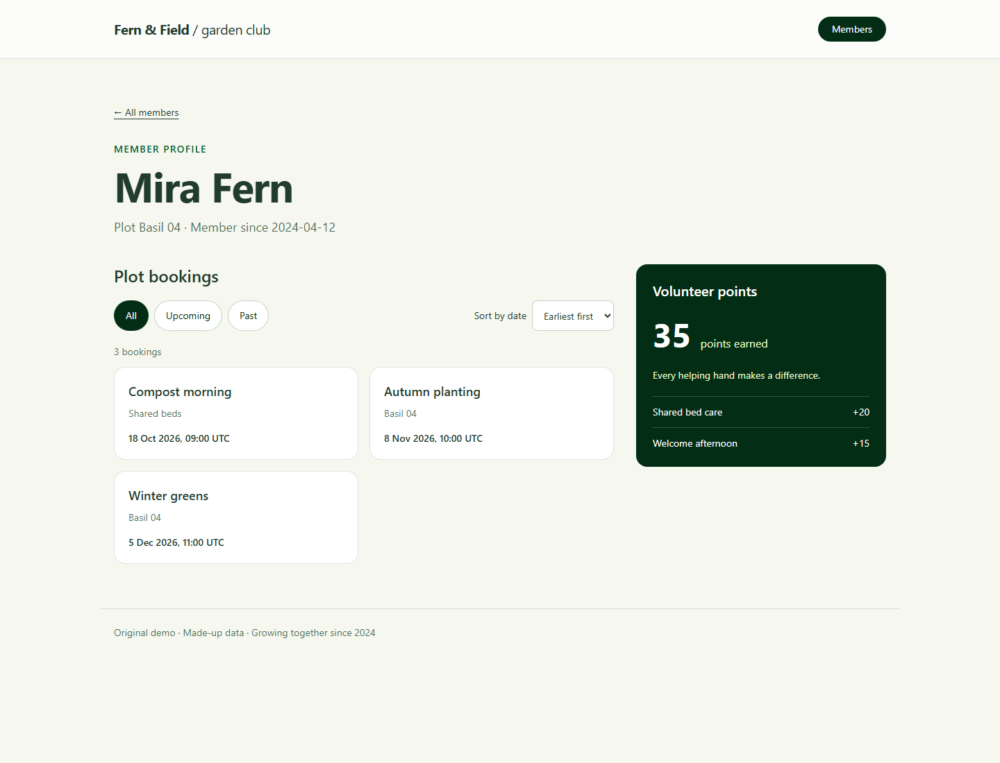

# Fern & Field · member dashboard

A community garden dashboard with member profiles, filterable plot bookings and volunteer contributions.

[](https://github.com/shawnrruss/demo-dashboard/actions/workflows/ci.yml)



Original demo, made-up data, not client work. AI-assisted implementation and tests.

## What it shows

- Astro generates four static pages; a React island hydrates the booking controls.
- Typed, asynchronous data functions clone fixture results to protect the data boundary.
- Booking filters and date sorting work together with accessible buttons, labels and live result announcements.
- Responsive Tailwind layouts serve member cards, bookings and volunteer totals without a backend.
- Vitest and Testing Library cover data isolation, booking logic and user interactions; CI also checks types, lint and the production build.

## Quick start

Use Node.js 22.12+ and npm. Dependencies are pinned in `package.json` and resolved in `package-lock.json`.

```sh
npm ci
npm run dev
```

Open the local URL printed by Astro. `/` lists members; each member links to
`/members/member-1/`, `/members/member-2/` or `/members/member-3/`.
All application data lives in `src/data/fixture.json`; the site makes no backend or external network requests.
No accounts, secrets, external fonts or real client assets are required.
Set `ASTRO_TELEMETRY_DISABLED=1` to disable build-tool telemetry.

## Tests and production build

```sh
npm test
npm run typecheck
npm run lint
npm run build
```

CI runs these commands after `npm ci` on pushes and pull requests with Node.js 22.
The static production site is generated in `dist/`. There is no deployment step.

To regenerate the committed preview using Playwright and Astro's built-site preview server:

```sh
npx playwright install chromium
npm run build
npm run preview:image
```

The script captures `/members/member-1/` at 1440 × 1100 and closes its browser and server.

## Project layout

| Path | Purpose |
| --- | --- |
| `src/pages/` | Member directory and statically generated profiles |
| `src/components/BookingsList.tsx` | Interactive booking filter and date sort |
| `src/lib/` | Typed fixture access and pure booking functions |
| `src/data/fixture.json` | Made-up members, bookings and volunteer activity |
| `src/layouts/`, `src/styles/` | Shared shell and Tailwind styling |
| `tests/` | Data, booking, interaction and CI-presence tests |
| `scripts/preview.mjs`, `docs/preview.png` | Reproducible product screenshot |
| `.github/workflows/ci.yml` | Install, tests, types, lint and build |

## Data boundary

`src/lib/data.ts` exports asynchronous `listMembers()`, `getMember(id)`,
`listBookings(memberId)` and `listVolunteerPoints(memberId)`. Results are typed
and cloned so consumers cannot mutate the fixture. Unknown members return null;
unknown booking/points queries return empty arrays. Replace this module to connect
a Supabase-style backend without changing the pages or components.
